# SRE Academy Final Project


This is my final project for the SRE Academy. The goal was to deploy an
application on Kubernetes and monitor it with Prometheus, Grafana and
Alertmanager, with alerts sent to a Slack channel.

I kept the app simple (a small orders API in Flask) so I could focus on the
monitoring part: metrics, dashboards and alerts.

For the setup I used the same tools we worked with in the course: Colima and
Minikube, Kubernetes manifests for each monitoring component, a Helm chart to
deploy everything and a `cluster.sh` script to run the setup.

Laura Muñoz, 2026

## Contents

- [What's included](#whats-included)
- [How it works](#how-it-works)
- [Repo structure](#repo-structure)
- [What you need](#what-you-need)
- [How to deploy it](#how-to-deploy-it)
- [How to use it](#how-to-use-it)
- [Metrics](#metrics)
- [SLOs](#slos)
- [Alerts](#alerts)
- [What to do when an alert fires](#what-to-do-when-an-alert-fires)
- [Slack setup](#slack-setup)
- [Testing an incident](#testing-an-incident)
- [CI/CD](#cicd)
- [Screenshots](#screenshots)
- [Troubleshooting](#troubleshooting)
- [Things I'd like to add](#things-id-like-to-add)
- [Cleanup](#cleanup)
- [Contributing and license](#contributing-and-license)

## What's included

| Requirement | What I did | Where |
|-------------|------------|-------|
| App that emits metrics | Flask API using the `prometheus_client` library | [`app/`](app/) |
| Kubernetes deployment | Deployed on Minikube (2 replicas, health checks, resource limits) | [`deployment.yaml`](sre-app-chart/templates/deployment.yaml) |
| Prometheus | Finds the app pods with the `prometheus.io/scrape` annotation and scrapes them | [`prometheus.yaml`](sre-app-chart/templates/prometheus.yaml) |
| Grafana | Dashboard with the four golden signals, provisioned from a ConfigMap | [`grafana.yaml`](sre-app-chart/templates/grafana.yaml) |
| Alertmanager | 4 alert rules in Prometheus, sent to Alertmanager | [`alertmanager.yaml`](sre-app-chart/templates/alertmanager.yaml) |
| Documentation | This README, LICENSE, CONTRIBUTING and screenshots | |
| Bonus: notifications | Alertmanager sends the alerts to a Slack channel | [`alertmanager.yaml`](sre-app-chart/templates/alertmanager.yaml) |
| Bonus: IaC | Everything is installed with one Helm chart | [`sre-app-chart/`](sre-app-chart/) |
| Bonus: CI/CD | GitHub Actions pipeline that tests, deploys to a test cluster and publishes the image | [`ci.yml`](.github/workflows/ci.yml) |

## How it works

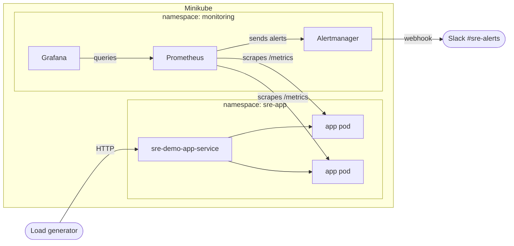

The way I understand the flow:

1. The app exposes its metrics at `/metrics`.
2. The app pods have the annotations `prometheus.io/scrape: "true"`,
   `prometheus.io/port` and `prometheus.io/path`. Prometheus uses Kubernetes
   service discovery to find the pods with those annotations, so I don't have
   to list the pods anywhere. If a pod gets replaced, Prometheus finds the new
   one by itself. That's why Prometheus has its own ServiceAccount and a
   ClusterRole that lets it read pods.
3. The alert rules are in a ConfigMap mounted in Prometheus. Prometheus checks
   them every 15 seconds and sends the ones that fire to Alertmanager.
4. Alertmanager groups the alerts and sends them to Slack. The webhook URL is
   in a Kubernetes Secret, not in the ConfigMap.
5. Grafana gets the Prometheus datasource and the dashboard from ConfigMaps,
   so they are saved in the repo instead of being created by hand in the UI.

## Repo structure

```
.
├── app/                        # Flask app, Dockerfile and unit tests
├── sre-app-chart/              # Helm chart
│   ├── Chart.yaml
│   ├── values.yaml
│   └── templates/
│       ├── deployment.yaml               # app Deployment and Service
│       ├── prometheus-rbac-cluster.yaml  # permissions for Prometheus
│       ├── prometheus.yaml               # config, alert rules, Deployment and Service
│       ├── alertmanager.yaml             # config, Slack secret, Deployment and Service
│       └── grafana.yaml                  # datasource, dashboard, Deployment and Service
├── cluster.sh                  # sets up everything
├── port-forward.sh             # opens the UIs on localhost
├── generate-load.sh            # sends traffic to the app
├── cleanup.sh                  # removes everything
├── .github/workflows/ci.yml    # CI/CD pipeline
└── docs/screenshots/           # evidence
```

## What you need

- [Colima](https://github.com/abiosoft/colima) (or Docker Desktop)
- [Minikube](https://minikube.sigs.k8s.io/docs/start/)
- [kubectl](https://kubernetes.io/docs/tasks/tools/)
- [Helm](https://helm.sh/docs/intro/install/)

On a Mac they can be installed with Homebrew (`cluster.sh` also installs them
if they're missing):

```bash
brew install colima docker minikube kubectl helm
```

Versions I used: Minikube 1.39, kubectl 1.37, Helm 4.3, Docker Engine 29.
The cluster needs around 4 CPUs and 6 GB of RAM.

## How to deploy it

```bash
git clone https://github.com/Laura-Munoz-Solano/sre-final-project-laura-munoz.git
cd sre-final-project-laura-munoz

# optional, only if you want Slack alerts (see "Slack setup")
export SLACK_WEBHOOK_URL="https://hooks.slack.com/services/..."

./cluster.sh
```

`cluster.sh` does this:

1. Checks that the tools are installed.
2. Starts Colima and Minikube if they're not running.
3. Removes a previous install of the project, if there is one.
4. Builds the app image inside Minikube (`minikube image build`).
5. Installs the Helm chart (`helm install sre-app ./sre-app-chart`).
6. Waits for the pods to be ready and shows their status.

If you prefer to do it by hand:

```bash
minikube image build -t sre-demo-app:1.0.0 ./app
helm install sre-app ./sre-app-chart --set-string slackWebhookUrl="$SLACK_WEBHOOK_URL"
kubectl get pods -n sre-app
kubectl get pods -n monitoring
```

## How to use it

Open the UIs on localhost (leave this running in its own terminal):

```bash
./port-forward.sh
```

| Service | URL |
|---------|-----|
| App | http://localhost:8080 |
| Prometheus | http://localhost:9090 |
| Alertmanager | http://localhost:9093 |
| Grafana | http://localhost:3000 (user `admin`, password `admin`, it asks to change it on the first login) |

Then send some traffic from another terminal:

```bash
./generate-load.sh normal 900   # normal traffic for 15 minutes
./generate-load.sh errors 900   # adds failing requests -> HighErrorRate alert
./generate-load.sh slow 900     # adds slow requests -> HighLatency alert
```

The dashboard is in Grafana under *Dashboards > SRE Demo App - Golden Signals*.

Two other ways to break things on purpose:

```bash
# make half of the orders fail
helm upgrade sre-app ./sre-app-chart --reuse-values --set errorRate=0.5

# take the app down completely -> AppDown alert
kubectl -n sre-app scale deployment sre-demo-app --replicas=0
```

## Metrics

I tried to cover the four golden signals from the course: traffic, errors,
latency and saturation.

| Metric | Type | What it tells me |
|--------|------|------------------|
| `http_requests_total` | Counter | Requests per endpoint, method and status code (traffic and errors) |
| `http_request_duration_seconds` | Histogram | How long requests take (latency) |
| `http_requests_in_progress` | Gauge | Requests being handled right now (saturation) |
| `process_resident_memory_bytes` | Gauge | Memory used by each pod (saturation, comes with the client library) |
| `orders_created_total` | Counter | Orders per product |

A few things I learned while doing this:

- The `endpoint` label uses the route (`/api/orders`) instead of the full URL,
  so the number of time series doesn't keep growing.
- I left the health checks and `/metrics` out of the traffic numbers, because
  otherwise the Kubernetes probes would count as user traffic.
- I used a histogram for latency so I can calculate percentiles (p50, p95,
  p99) across both pods.

Some queries I used a lot:

```promql
# requests per second by endpoint
sum(rate(http_requests_total{job="sre-demo-app"}[2m])) by (endpoint)

# error rate
sum(rate(http_requests_total{job="sre-demo-app", status=~"5.."}[2m])) / sum(rate(http_requests_total{job="sre-demo-app"}[2m]))

# p95 latency
histogram_quantile(0.95, sum(rate(http_request_duration_seconds_bucket{job="sre-demo-app"}[2m])) by (le))
```

## SLOs

These are the targets I picked for the app. Since it's a demo the numbers are
my own choice, but I wanted to practice writing them down:

- **Availability:** 99% of requests should not return a 5xx error. That leaves
  an error budget of 1%, which over 30 days is roughly 7 hours of total
  downtime.
- **Latency:** 95% of requests should take less than 250 ms.

How I would measure them in Prometheus:

```promql
# availability
sum(rate(http_requests_total{job="sre-demo-app", status!~"5.."}[30d])) / sum(rate(http_requests_total{job="sre-demo-app"}[30d]))

# latency (250 ms is one of the default histogram buckets)
sum(rate(http_request_duration_seconds_bucket{job="sre-demo-app", le="0.25"}[30d])) / sum(rate(http_request_duration_seconds_count{job="sre-demo-app"}[30d]))
```

With normal traffic the app had 0% errors and a p95 well under 250 ms, so it
was inside both.

My alerts are simpler than these SLOs (fixed thresholds). I read about
"burn rate" alerts, which are the more correct way to alert on SLOs, but I
didn't get to implement them yet.

## Alerts

| Alert | When it fires | Waits | Severity |
|-------|---------------|-------|----------|
| `HighErrorRate` | More than 5% of requests return 5xx | 2 min | critical |
| `HighLatency` | p95 latency is over 1 second | 2 min | warning |
| `AppDown` | Prometheus can't scrape any app pod | 1 min | critical |
| `PodRestarting` | A pod restarted more than twice in 10 minutes | | warning |

The "waits" column is the `for:` setting. The condition has to stay true for
that long before the alert fires, so a short spike doesn't send a message.

For `PodRestarting` I used `process_start_time_seconds`, a metric that the
Python client exposes by default. It changes every time the container starts,
so counting its changes tells me how many times the pod restarted.

In Alertmanager I also set up:

- **Grouping** by alert name, so several pods with the same problem become one
  message.
- **Resolved notifications**, so Slack also tells me when the problem is gone.
- **An inhibition rule:** if `AppDown` is firing, the warning alerts are muted,
  because they would just be noise from the same problem.

## What to do when an alert fires

Short notes for each alert, like a mini runbook.

**HighErrorRate**

1. See which endpoint is failing:
   `sum(rate(http_requests_total{job="sre-demo-app", status=~"5.."}[5m])) by (endpoint)`
2. Check the pods and their logs:
   `kubectl -n sre-app get pods` and `kubectl -n sre-app logs deploy/sre-demo-app --tail=100`
3. Check if something changed recently: `helm history sre-app`
4. Fix: roll back with `helm rollback sre-app`, or set `errorRate` back to 0
   if it was failure injection.

**HighLatency**

1. See which endpoint is slow:
   `histogram_quantile(0.95, sum(rate(http_request_duration_seconds_bucket{job="sre-demo-app"}[5m])) by (le, endpoint))`
2. Look at the saturation panels in Grafana (requests in progress, memory).
3. Fix: add replicas with
   `kubectl -n sre-app scale deployment sre-demo-app --replicas=4` and look for
   the slow part (in this app it's `/api/slow`).

**AppDown**

1. Check if the pods exist and are running: `kubectl -n sre-app get pods`
2. If they're running, check the target in Prometheus (*Status > Target health*).
3. Fix: `kubectl -n sre-app scale deployment sre-demo-app --replicas=2`, or roll back.

**PodRestarting**

1. See why the pod restarted:
   `kubectl -n sre-app describe pod <pod>` and `kubectl -n sre-app logs <pod> --previous`
2. `OOMKilled` means it ran out of memory; probe failures mean the app is too
   slow to answer `/healthz`.
3. Fix: roll back, or change the `resources` in `deployment.yaml`.

## Slack setup

1. Create a channel called `#sre-alerts`.
2. Go to [api.slack.com/apps](https://api.slack.com/apps), create a **Blank
   app**, add the `incoming-webhook` scope and install it in your workspace.
3. In **Incoming Webhooks**, add a webhook for `#sre-alerts` and copy the URL.
4. Test it:
   ```bash
   export SLACK_WEBHOOK_URL="https://hooks.slack.com/services/..."
   curl -X POST -H 'Content-type: application/json' --data '{"text":"test"}' "$SLACK_WEBHOOK_URL"
   ```
5. Run `./cluster.sh` in the same terminal.

The webhook URL works like a password, so `cluster.sh` passes it to Helm with
`--set-string` and Helm puts it in a Kubernetes Secret. It's not saved
anywhere in the repo. If the variable is empty, Alertmanager still runs but
uses a "null" receiver.

## Testing an incident

To check that everything worked end to end, I ran the error load generator
and wrote down what happened (times are Costa Rica time):

| Time | What happened |
|------|---------------|
| 9:45 | Started `./generate-load.sh errors 900`. About 9% of requests started failing |
| 9:47 | `HighErrorRate` went to **Pending** in Prometheus |
| 9:49 | After 2 minutes it changed to **Firing** (error rate was 9.4%) |
| 9:49 | The `[FIRING]` message arrived in Slack |
| 10:00 | The load generator finished |
| 10:03 | The `[RESOLVED]` message arrived in Slack |

It took about 4 minutes from the first errors to the Slack message. That
makes sense: the query uses a 2-minute window, then the `for:` waits 2 more
minutes, and Alertmanager waits 30 seconds before sending a new group.

One thing I noticed: the `[RESOLVED]` message still shows the last error
rate (9.341%). Alertmanager sends the description from the last time the
alert was active, not the current value.

Something I didn't plan: while I was working on the project my laptop went to
sleep a couple of times, and both times I got an "app down" alert in Slack
that resolved by itself when the laptop woke up. It was nice to see the
monitoring catch a real outage and not only the one I caused on purpose.

## CI/CD

The pipeline is in [`.github/workflows/ci.yml`](.github/workflows/ci.yml) and
runs on every push and pull request to `main`:

1. **Run Tests and Quality Checks**: flake8 and the unit tests.
2. **Validate Helm Chart**: `helm lint` and `helm template`.
3. **Deploy to Test Cluster (kind)**: builds the image, creates a temporary
   Kubernetes cluster with kind, installs the chart (only the app) and checks
   that `/healthz` and `/metrics` respond.
4. **Build and Push Image**: only on `main`, pushes the image to GitHub
   Container Registry.

Each job needs the previous ones to pass, so a broken image never gets
published.

## Screenshots

**Pods running**

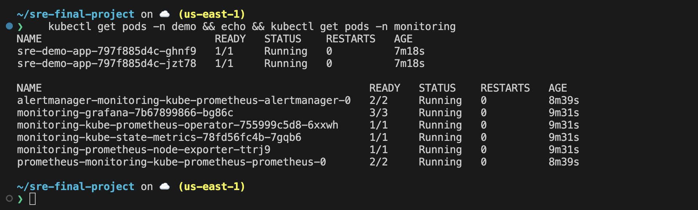

**The app's /metrics endpoint**

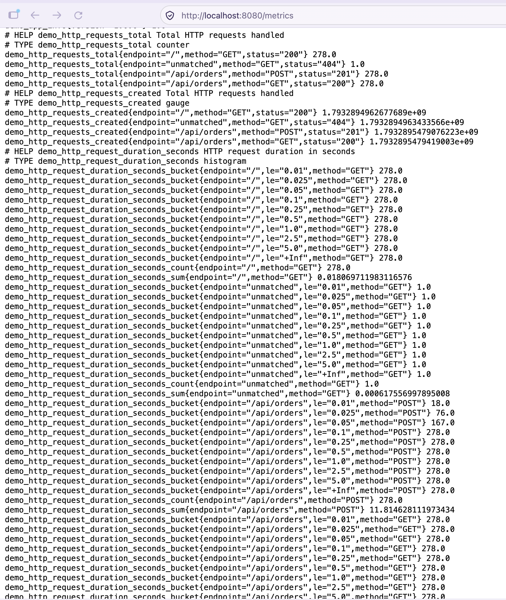

**Prometheus finding both app pods**

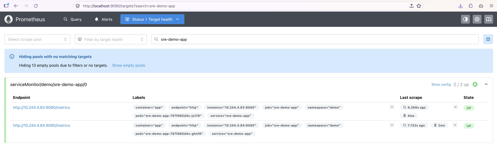

**Requests per second by endpoint in Prometheus**

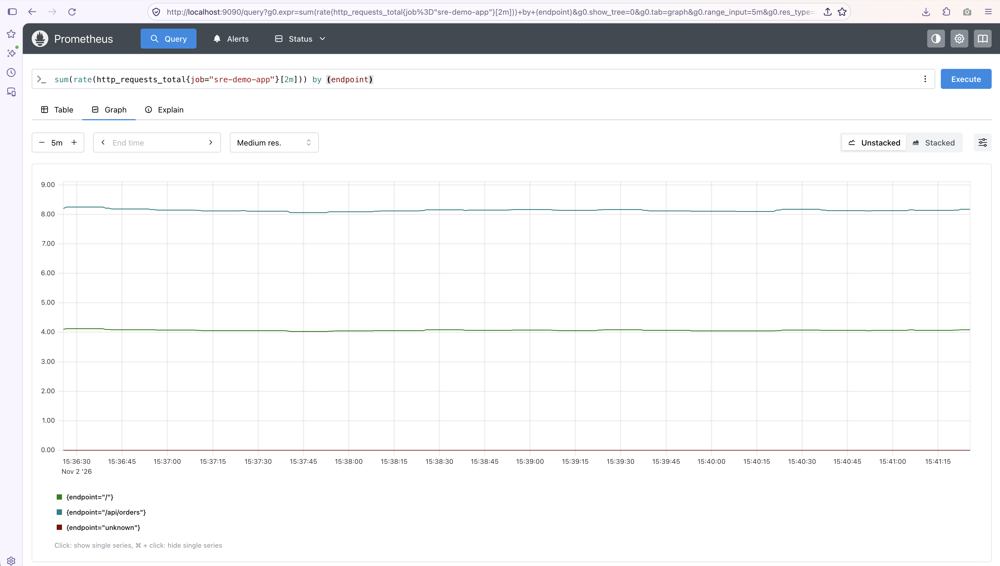

**Alert rules in Prometheus**

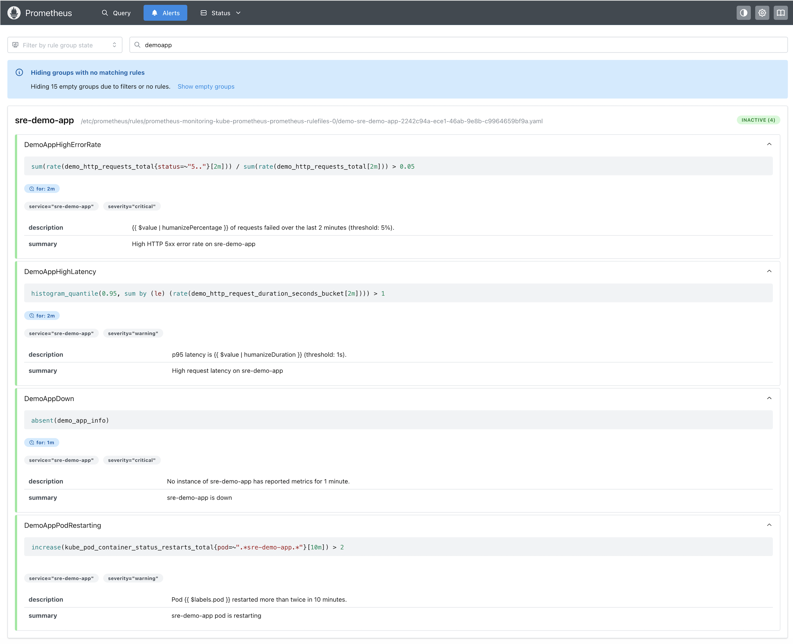

**Grafana dashboard**

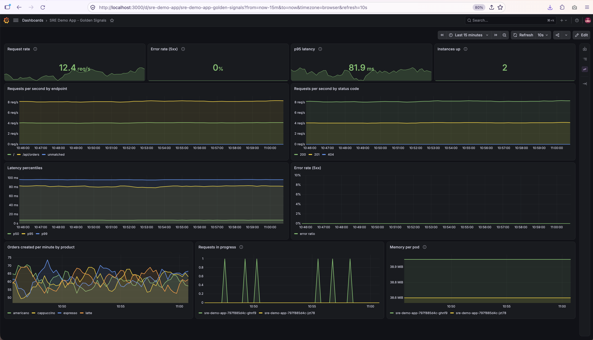

**Error rate alert firing**

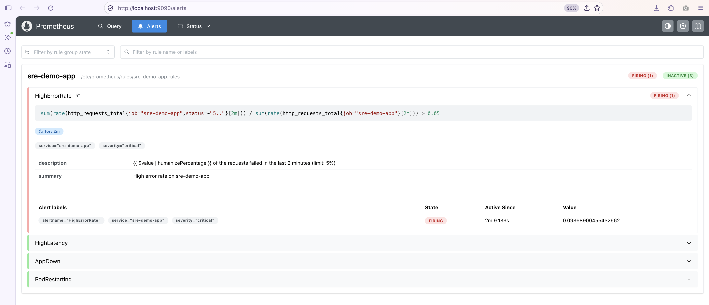

**The alert in Alertmanager**

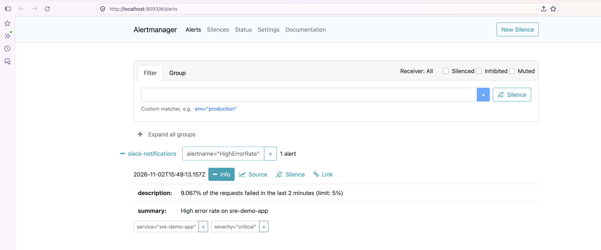

**Slack messages (firing and resolved)**

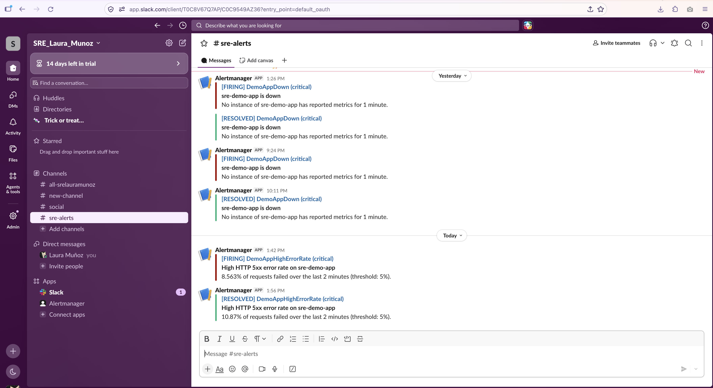

**CI/CD pipeline**

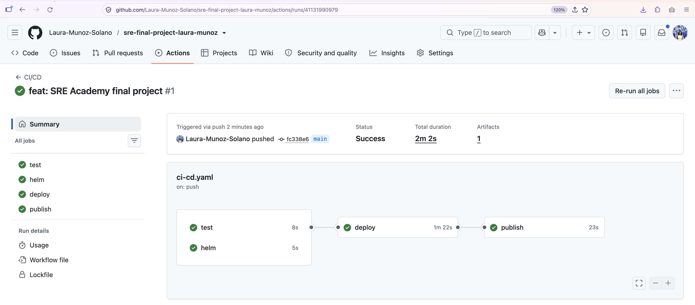

## Troubleshooting

| Problem | What worked for me |
|---------|--------------------|
| `docker version` has no "Server" section | Start Docker: `colima start` (or open Docker Desktop) |
| App pods stuck in `ErrImageNeverPull` or `ImagePullBackOff` | Build the image inside Minikube: `minikube image build -t sre-demo-app:1.0.0 ./app` |
| Prometheus shows only a target called `prometheus` | Something else is using port 9090. Check with `lsof -nP -iTCP:9090 -sTCP:LISTEN`, stop it and restart the port-forward |
| The `sre-demo-app` target is missing in Prometheus | Check the pod annotations: `kubectl -n sre-app get pods -o yaml \| grep prometheus.io` |
| I changed an alert rule but Prometheus still shows the old one | Restart Prometheus: `kubectl -n monitoring rollout restart deployment prometheus-deployment` |
| Pods stuck in `Pending` | Minikube needs more resources: `minikube delete && minikube start --cpus=4 --memory=6g` |
| No Slack message | Check the Alertmanager logs: `kubectl -n monitoring logs deploy/alertmanager-deployment` |
| Nothing works after the laptop slept | Run `colima start`, `minikube start` and `./port-forward.sh` again |

## Things I'd like to add

- Burn-rate alerts based on the SLOs instead of fixed thresholds.
- Logs with Loki, like in the course exercises, to see them next to the metrics.
- Autoscaling (HPA) based on traffic.
- Deploying with Argo CD.
- Persistent storage for Prometheus (right now it uses `emptyDir`, so the data
  is lost if the pod restarts).

## Cleanup

```bash
./cleanup.sh            # removes the Helm release and the namespaces
minikube stop           # stops the cluster
colima stop
```

## Contributing and license

See [CONTRIBUTING.md](CONTRIBUTING.md). The project uses the
[MIT License](LICENSE.md).
