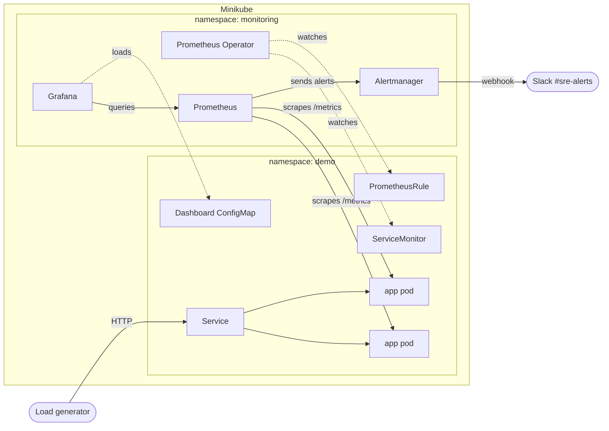

# SRE Academy Final Project


This is my final project for the SRE Academy. It's a small Python app (a fake
coffee shop orders API) running on Kubernetes, monitored with Prometheus and
Grafana, with alerts that go through Alertmanager to a Slack channel.

The app itself is very simple on purpose. The point of the project was to
practice the monitoring side: exposing metrics, collecting them, building a
dashboard, writing alerts, and checking that an alert actually reaches me
when something breaks.

This was my first time working with most of these tools, so I also included a
section at the end about the problems I ran into and how I fixed them.

Laura Muñoz, 2026

## Contents

- [What's included](#whats-included)
- [How it works](#how-it-works)
- [Repo structure](#repo-structure)
- [What you need](#what-you-need)
- [How to deploy it](#how-to-deploy-it)
- [How to use it](#how-to-use-it)
- [Metrics](#metrics)
- [SLOs](#slos)
- [Alerts](#alerts)
- [What to do when an alert fires](#what-to-do-when-an-alert-fires)
- [Slack setup](#slack-setup)
- [Testing an incident](#testing-an-incident)
- [CI/CD](#cicd)
- [Problems I ran into](#problems-i-ran-into)
- [Screenshots](#screenshots)
- [Troubleshooting](#troubleshooting)
- [Things I'd like to add](#things-id-like-to-add)
- [Cleanup](#cleanup)
- [Contributing and license](#contributing-and-license)

## What's included

| Requirement | What I did | Where |
|-------------|------------|-------|
| App that emits metrics | Flask API using the `prometheus_client` library | [`app/`](app/) |
| Kubernetes deployment | Deployed on Minikube with a Helm chart (2 replicas, health checks, resource limits) | [`charts/sre-demo-app/`](charts/sre-demo-app/) |
| Prometheus | Scrapes the app automatically through a `ServiceMonitor` | [`servicemonitor.yaml`](charts/sre-demo-app/templates/servicemonitor.yaml) |
| Grafana | Dashboard with the four golden signals, loaded from a JSON file | [`dashboard.json`](charts/sre-demo-app/files/dashboard.json) |
| Alertmanager | 4 alert rules, routed by labels | [`alert-rules.yaml`](charts/sre-demo-app/files/alert-rules.yaml) |
| Documentation | This README, LICENSE, CONTRIBUTING and screenshots | |
| Bonus: notifications | Alerts are sent to a Slack channel | [`alertmanager-slack-values.yaml`](monitoring/alertmanager-slack-values.yaml) |
| Bonus: IaC | Everything is installed with Helm and values files | [`charts/`](charts/), [`monitoring/`](monitoring/) |
| Bonus: CI/CD | GitHub Actions pipeline that tests, deploys to a test cluster and publishes the image | [`ci-cd.yaml`](.github/workflows/ci-cd.yaml) |

## How it works



The way I understand the flow:

1. The app exposes its metrics at `/metrics`.
2. My Helm chart creates a `ServiceMonitor`. The Prometheus Operator reads it
   and tells Prometheus to scrape every pod behind the app's Service. I don't
   have to list the pods anywhere, so if a pod gets replaced, Prometheus
   finds the new one by itself.
3. The chart also creates a `PrometheusRule` with my alert rules. Prometheus
   checks them every 15 seconds and sends the ones that fire to Alertmanager.
4. Alertmanager sends alerts with the label `service=sre-demo-app` to Slack.
   Other alerts from the cluster go to a "null" receiver so the channel only
   gets alerts about my app.
5. Grafana reads from Prometheus. The dashboard lives in a ConfigMap, so it's
   saved in the repo instead of being built by hand in the UI.

For the monitoring stack I used the
[kube-prometheus-stack](https://github.com/prometheus-community/helm-charts/tree/main/charts/kube-prometheus-stack)
Helm chart, which installs Prometheus, Alertmanager, Grafana and the Operator
together.

## Repo structure

```
.
├── app/                     # Flask app, Dockerfile and unit tests
├── charts/sre-demo-app/     # Helm chart for the app
│   ├── templates/           # Deployment, Service, ServiceMonitor, PrometheusRule, dashboard
│   ├── files/               # alert-rules.yaml and dashboard.json
│   └── values.yaml
├── monitoring/              # values for kube-prometheus-stack and Slack routing
├── scripts/                 # setup, port-forward, load generator, teardown
├── .github/workflows/       # CI/CD pipeline
└── docs/screenshots/        # evidence
```

## What you need

- Docker. I used [Colima](https://github.com/abiosoft/colima) on a Mac, but
  Docker Desktop should work too.
- [Minikube](https://minikube.sigs.k8s.io/docs/start/)
- [kubectl](https://kubernetes.io/docs/tasks/tools/)
- [Helm](https://helm.sh/docs/intro/install/)

On a Mac:

```bash
brew install colima docker minikube kubectl helm
colima start --cpu 4 --memory 8
```

Versions I used: Minikube 1.39, kubectl 1.37, Helm 4.3, Docker Engine 29.
The cluster needs around 4 CPUs and 6 GB of RAM.

## How to deploy it

The easy way is the setup script:

```bash
git clone https://github.com/Laura-Munoz-Solano/sre-final-project-laura-munoz.git
cd sre-final-project-laura-munoz

# optional, only if you want Slack alerts (see "Slack setup")
export SLACK_WEBHOOK_URL="https://hooks.slack.com/services/..."

./scripts/setup.sh
```

The script starts Minikube, installs the monitoring stack, builds the app
image inside Minikube and installs the app. It took me about 3 minutes. You
can run it again safely; it just updates what's already there.

If you prefer to do it step by step:

```bash
minikube start --cpus=4 --memory=6g

helm repo add prometheus-community https://prometheus-community.github.io/helm-charts
helm repo update
helm upgrade --install monitoring prometheus-community/kube-prometheus-stack \
  --namespace monitoring --create-namespace \
  -f monitoring/kube-prometheus-stack-values.yaml --wait --timeout 10m

minikube image build -t sre-demo-app:1.0.0 app/

helm upgrade --install sre-demo-app charts/sre-demo-app \
  --namespace demo --create-namespace --wait

kubectl get pods -n demo
kubectl get pods -n monitoring
```

## How to use it

Open the UIs on localhost (leave this running in its own terminal):

```bash
./scripts/port-forward.sh
```

| Service | URL |
|---------|-----|
| App | http://localhost:8080 |
| Prometheus | http://localhost:9090 |
| Alertmanager | http://localhost:9093 |
| Grafana | http://localhost:3000 (user `admin`, password `sre-academy`, only for local testing) |

Then send some traffic from another terminal:

```bash
./scripts/generate-load.sh normal 900   # normal traffic for 15 minutes
./scripts/generate-load.sh errors 900   # adds failing requests -> error rate alert
./scripts/generate-load.sh slow 900     # adds slow requests -> latency alert
```

The dashboard is in Grafana under *Dashboards > SRE Demo App - Golden Signals*.

Two other ways to break things on purpose:

```bash
# make half of the orders fail
helm upgrade sre-demo-app charts/sre-demo-app -n demo --reuse-values --set errorRate=0.5

# take the app down completely
kubectl -n demo scale deployment sre-demo-app --replicas=0
```

## Metrics

I tried to cover the four golden signals from the course: traffic, errors,
latency and saturation.

| Metric | Type | What it tells me |
|--------|------|------------------|
| `demo_http_requests_total` | Counter | Requests per endpoint, method and status code (traffic and errors) |
| `demo_http_request_duration_seconds` | Histogram | How long requests take (latency) |
| `demo_http_requests_in_progress` | Gauge | Requests being handled right now (saturation) |
| `process_resident_memory_bytes` | Gauge | Memory used by each pod (saturation) |
| `demo_orders_created_total` | Counter | Orders per product (a "business" metric) |
| `demo_app_info` | Info | App version; also used to check if the app is up |

A few things I learned while doing this:

- The `endpoint` label uses the route (`/api/orders`) instead of the full URL,
  so the number of time series doesn't keep growing.
- I left the health check and `/metrics` requests out of the traffic numbers,
  because otherwise Kubernetes probes would count as user traffic.
- I used a histogram for latency so I can calculate percentiles (p50, p95,
  p99) across both pods.

Some queries I used a lot:

```promql
# requests per second by endpoint
sum(rate(demo_http_requests_total[2m])) by (endpoint)

# error rate
sum(rate(demo_http_requests_total{status=~"5.."}[2m])) / sum(rate(demo_http_requests_total[2m]))

# p95 latency
histogram_quantile(0.95, sum(rate(demo_http_request_duration_seconds_bucket[2m])) by (le))
```

## SLOs

These are the targets I picked for the app. Since it's a demo the numbers are
my own choice, but I wanted to practice writing them down:

- **Availability:** 99% of requests should not return a 5xx error. That leaves
  an error budget of 1%, which over 30 days is roughly 7 hours of total
  downtime.
- **Latency:** 95% of requests should take less than 250 ms.

How I would measure them in Prometheus:

```promql
# availability
sum(rate(demo_http_requests_total{status!~"5.."}[30d])) / sum(rate(demo_http_requests_total[30d]))

# latency (250 ms is one of the histogram buckets)
sum(rate(demo_http_request_duration_seconds_bucket{le="0.25"}[30d])) / sum(rate(demo_http_request_duration_seconds_count[30d]))
```

With normal traffic the app had 0% errors and a p95 of about 80 ms, so it was
well inside both.

My alerts are simpler than these SLOs (fixed thresholds). I read about
"burn rate" alerts, which are the more correct way to alert on SLOs, but I
didn't get to implement them yet.

## Alerts

| Alert | When it fires | Waits | Severity |
|-------|---------------|-------|----------|
| `DemoAppHighErrorRate` | More than 5% of requests return 5xx | 2 min | critical |
| `DemoAppHighLatency` | p95 latency is over 1 second | 2 min | warning |
| `DemoAppDown` | Prometheus can't get metrics from any pod | 1 min | critical |
| `DemoAppPodRestarting` | A pod restarted more than twice in 10 minutes | | warning |

The "waits" column is the `for:` setting. The condition has to stay true for
that long before the alert fires, so a short spike doesn't send a message.

In Alertmanager I also set up:

- **Grouping** by alert name, so several pods with the same problem become one
  message.
- **Resolved notifications**, so Slack also tells me when the problem is gone.
- **An inhibition rule:** if `DemoAppDown` is firing, the warning alerts for the
  app are muted, because they would just be noise from the same problem.

## What to do when an alert fires

Short notes for each alert, like a mini runbook.

**DemoAppHighErrorRate**

1. See which endpoint is failing:
   `sum(rate(demo_http_requests_total{status=~"5.."}[5m])) by (endpoint)`
2. Check the pods and their logs:
   `kubectl -n demo get pods` and `kubectl -n demo logs deploy/sre-demo-app --tail=100`
3. Check if something changed recently: `helm -n demo history sre-demo-app`
4. Fix: roll back with `helm -n demo rollback sre-demo-app`, or set
   `errorRate` back to 0 if it was failure injection.

**DemoAppHighLatency**

1. See which endpoint is slow:
   `histogram_quantile(0.95, sum(rate(demo_http_request_duration_seconds_bucket[5m])) by (le, endpoint))`
2. Look at the saturation panels in Grafana (requests in progress, memory).
3. Fix: add replicas with
   `kubectl -n demo scale deployment sre-demo-app --replicas=4` and look for
   the slow part (in this app it's `/api/slow`).

**DemoAppDown**

1. Check if the pods exist and are running: `kubectl -n demo get pods`
2. If they're running, check the target in Prometheus (*Status > Target health*)
   and the Service: `kubectl -n demo get svc,servicemonitor,endpoints`
3. Fix: `kubectl -n demo scale deployment sre-demo-app --replicas=2`, or roll back.

**DemoAppPodRestarting**

1. See why the pod restarted:
   `kubectl -n demo describe pod <pod>` and `kubectl -n demo logs <pod> --previous`
2. `OOMKilled` means it ran out of memory; probe failures mean the app is too
   slow to answer `/healthz`.
3. Fix: roll back, or change the `resources` in `values.yaml`.

## Slack setup

1. Create a channel called `#sre-alerts`.
2. Go to [api.slack.com/apps](https://api.slack.com/apps), create a **Blank
   app**, add the `incoming-webhook` scope and install it in your workspace.
3. In **Incoming Webhooks**, add a webhook for `#sre-alerts` and copy the URL.
4. Test it:
   ```bash
   export SLACK_WEBHOOK_URL="https://hooks.slack.com/services/..."
   curl -X POST -H 'Content-type: application/json' --data '{"text":"test"}' "$SLACK_WEBHOOK_URL"
   ```
5. Run `./scripts/setup.sh` in the same terminal.

The webhook URL works like a password, so it's passed in when installing and
it's not saved anywhere in the repo.

## Testing an incident

To check that everything worked end to end, I ran the error load generator
and wrote down what happened:

| Time | What happened |
|------|---------------|
| 13:39 | Started `generate-load.sh errors`. About 9% of requests started failing |
| ~13:40 | `DemoAppHighErrorRate` went to **Pending** in Prometheus |
| 13:41 | After 2 minutes it changed to **Firing** (error rate was 8.9%) |
| 13:42 | The `[FIRING]` message arrived in Slack |
| 13:54 | The load generator finished |
| 13:56 | The `[RESOLVED]` message arrived in Slack |

So it took about 3 minutes from the first errors to the Slack message, which
makes sense with the 2-minute window in the query plus the 2-minute `for:`.

Something I didn't plan: while I was working on the project my laptop went to
sleep a couple of times, and both times I got a `DemoAppDown` alert in Slack
that resolved by itself when the laptop woke up. It was nice to see the
monitoring catch a real outage and not only the one I caused on purpose.

## CI/CD

The pipeline is in [`.github/workflows/ci-cd.yaml`](.github/workflows/ci-cd.yaml)
and runs on every push and pull request:

1. **test**: runs flake8 and the unit tests.
2. **helm**: checks that the Helm chart is valid.
3. **deploy**: builds the image, creates a temporary Kubernetes cluster with
   kind, installs the chart and checks that `/healthz` and `/metrics` respond.
4. **publish**: only on `main`, pushes the image to GitHub Container Registry.

Each step needs the previous one to pass, so a broken image never gets
published.

## Problems I ran into

This part took me the most time, so I wanted to write it down.

**Prometheus only showed one target.** When I opened Prometheus I only saw a
target called `prometheus` and none of my app. It turned out I had another
Prometheus installed on my Mac from an earlier lab, already using port 9090,
so the port-forward couldn't use it and the browser was showing the wrong
Prometheus. I found it with `lsof -nP -iTCP:9090 -sTCP:LISTEN` and stopped it
with `brew services stop prometheus`.

**My graphs showed `endpoint="http"` instead of my routes.** Prometheus adds
its own label called `endpoint` (the port name, `http`), and by default it
replaces the app's label with the same name. I fixed it by adding
`honorLabels: true` to the ServiceMonitor so the app's label is kept.

**The load generator kept stopping.** When I restarted the port-forward, one
request failed and the whole script stopped because of `set -e`. I removed the
`-e` so it keeps sending traffic even if a request fails.

**The memory panel in Grafana said "No data".** The query used container
metrics that didn't return anything for my app in Minikube on Colima. I
changed it to `process_resident_memory_bytes`, which the app exposes itself.

**Docker wasn't connecting.** `docker version` failed because my Docker CLI
was pointing to Colima, which wasn't running. `colima start` fixed it.

**The error rate graph went up to 10000%.** When all values were 0, Grafana
picked a weird scale for the axis. I set a soft max of 10% so it's readable
and still grows if errors go higher.

## Screenshots

**Pods running**


**The app's /metrics endpoint**


**Prometheus finding both app pods**


**Requests per second by endpoint in Prometheus**


**Alert rules in Prometheus**


**Grafana dashboard**


**Error rate alert firing**


**The alert in Alertmanager, routed to Slack**


**Slack messages (firing and resolved)**


**CI/CD pipeline**


## Troubleshooting

| Problem | What worked for me |
|---------|--------------------|
| `docker version` has no "Server" section | Start Docker: `colima start` (or open Docker Desktop) |
| App pods stuck in `ErrImageNeverPull` | Build the image inside Minikube: `minikube image build -t sre-demo-app:1.0.0 app/` |
| Prometheus shows only a target called `prometheus` | Something else is using port 9090. Check with `lsof -nP -iTCP:9090 -sTCP:LISTEN`, stop it and restart the port-forward |
| Graphs show `endpoint="http"` | The ServiceMonitor needs `honorLabels: true` |
| Dashboard doesn't show up in Grafana | Wait a minute, then check `kubectl get configmap -n demo -l grafana_dashboard=1` |
| Pods stuck in `Pending` | Minikube needs more resources: `minikube delete && minikube start --cpus=4 --memory=6g` |
| No Slack message | Check the Alertmanager logs: `kubectl logs -n monitoring alertmanager-monitoring-kube-prometheus-alertmanager-0` |
| Nothing works after the laptop slept | Run `colima start` and `minikube start`; everything comes back |

## Things I'd like to add

- Burn-rate alerts based on the SLOs instead of fixed thresholds.
- Logs with Loki so I can see them next to the metrics in Grafana.
- Autoscaling (HPA) based on traffic.
- Deploying with Argo CD and trying a cloud cluster.
- Storing the Slack webhook in a Kubernetes Secret.

## Cleanup

```bash
./scripts/teardown.sh   # removes the app and the monitoring stack
minikube delete         # removes the cluster
```

## Contributing and license

See [CONTRIBUTING.md](CONTRIBUTING.md). The project uses the
[MIT License](LICENSE.md).
